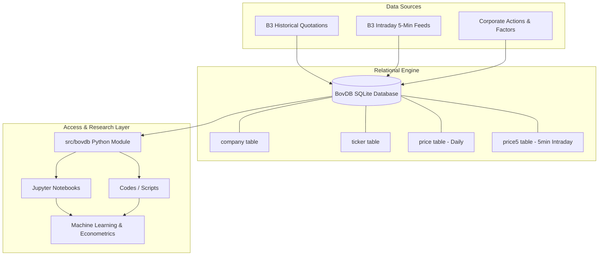
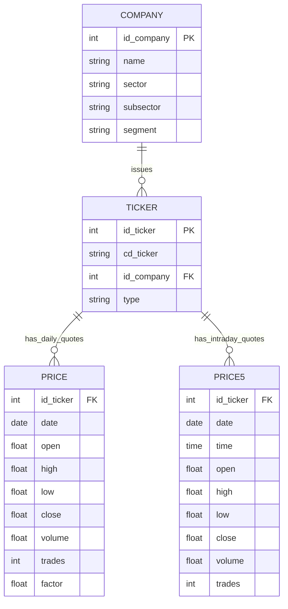

# BovDB Architecture & Design

## 1. Overview

**BovDB** is a relational database designed to store, organize, and serve historical and intraday financial market data from the Brazilian Stock Exchange (**B3**). Built as an open-access resource for machine learning and econometric research, BovDB provides clean, pre-processed time series that account for corporate events (stock splits, inplit, and dividends) via adjustment factors.

---

## 2. Relational Schema Architecture

The database is implemented in **SQLite**, balancing zero-configuration portability, fast read performance, and standard SQL support.

### Entities and Relationships

---

## 3. Data Flow & Integration

1. **Extraction and Ingestion**: Raw daily files from B3 and intraday 5-minute ticks are harmonized into relational tables with consistent data types (`INTEGER`, `TEXT`, `REAL`).
2. **Adjustment Factor Application**: Prices in the `price` table are stored in nominal terms along with a `factor` multiplier. Adjusted prices are computed as:
   $$\text{Price}_{\text{adjusted}} = \frac{\text{Price}_{\text{nominal}}}{\text{factor}}$$
3. **Consumption**: End-user research workflows query the database directly using SQL or via the `bovdb` Python helper module (`src/bovdb`).
