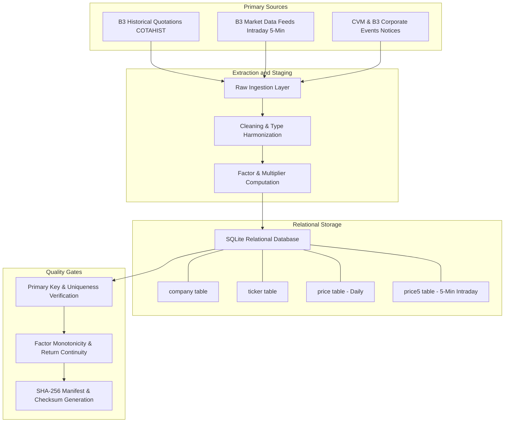

# BovDB Data Provenance & Lineage Specification

## 1. Overview

This document specifies the end-to-end data provenance, origin feeds, extraction procedures, normalization pipelines, and quality gates used to produce the **BovDB** relational dataset.

> **Official Published Dataset (V2)**: Souza, A. S. et al. (2024). *Dataset for Intraday Analysis of B3 stock prices*. Harvard Dataverse. DOI: [10.7910/DVN/TMB4IG](https://doi.org/10.7910/DVN/TMB4IG)

---

## 2. Source Data Acquisition

1. **Daily Historical Quotes (COTAHIST)**:
   - **Source**: Brasil, Bolsa, Balcão (B3) official historical price files (`COTAHIST_AAAA.TXT`).
   - **Coverage**: All listed companies, common shares (`ON`), preferred shares (`PN`), units (`UNT`), and BDRs from 1995 to the present.
   - **Fields**: Date, ticker symbol, share class, open, high, low, close, average price, total trades, traded volume.

2. **Intraday High-Frequency Feeds**:
   - **Source**: B3 high-frequency tick market data feeds aggregated into 5-minute fixed time bars (`price5`).
   - **Timestamps**: Expressed in Brasília Time (BRT / UTC-3).

3. **Corporate Actions & Factor Multipliers**:
   - **Source**: Official B3 Notice to Shareholders (*Avisos aos Acionistas*) and CVM regulatory filings.
   - **Events Tracked**: Stock splits (*desdobramentos*), reverse splits (*grupamentos*), and stock dividends/bonuses.

---

## 3. Data Processing & Harmonization Pipeline

1. **Harmonization**:
   - Date format standardized to ISO 8601 (`YYYY-MM-DD`).
   - Timestamps standardized to `HH:MM:SS`.
   - Prices converted to Brazilian Reais (BRL, `REAL` floating-point).
2. **Corporate Action Adjustment**:
   - Prices in the `price` table are preserved in nominal terms.
   - A cumulative adjustment factor (`factor`) is maintained for each ticker:
     $$\text{Price}_{\text{adjusted}}(t) = \frac{\text{Price}_{\text{nominal}}(t)}{\text{factor}(t)}$$
3. **Relational Integrity Validation**:
   - Foreign key consistency between `ticker(id_company)` and `company(id_company)`.
   - Primary key uniqueness on `price(id_ticker, date)` and `price5(id_ticker, date, time)`.
   - Range validation: $\text{low} \le \text{open}, \text{close} \le \text{high}$, $\text{volume} \ge 0$, $\text{trades} \ge 0$.
