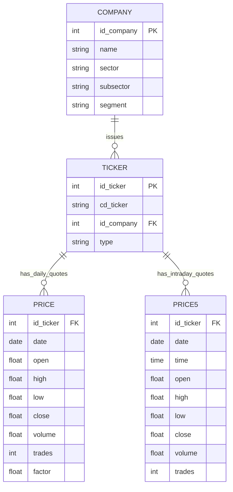

# 🏛️ Architecture & Schema Design

## 1. Relational Architecture

BovDB uses a normalized SQLite schema designed for maximum query speed and minimal dependency footprint.

---

## 2. High-Frequency Layer Integration

The database unifies both daily and intraday resolutions:
1. **Daily Layer (`price`)**: Ideal for multi-decade backtests, asset allocation models, and long-term risk parity strategies (1995 to present).
2. **Intraday Layer (`price5`)**: Ideal for microstructural analysis, order book volatility estimation, and high-frequency algorithmic execution modeling.
